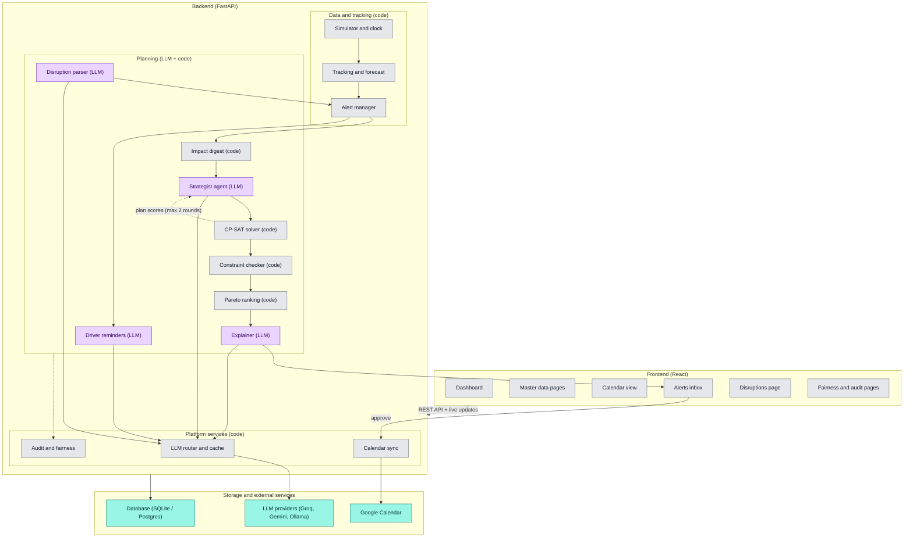

# Training Optimiser (v2)

> **Status: Planned.** This repository is new and nothing is built yet. This README describes the system we plan to build in 14 phases. Every section describes planned work unless it says otherwise.

Training Optimiser is a mini ERP web app for a driver training department. It tracks yearly training targets per course against actual completions. It forecasts which courses will miss their target. It uses generative AI and an optimisation solver to propose schedule fixes. A trainer approves a plan, and the plan is synced to Google Calendar. The app updates live as a simulated clock moves through the year.

This is a Generative AI course project for Topic 5, "Dynamic Training Efficiency & Smart Calendar Optimiser".

## Core idea

The LLM decides what kind of plan to try and writes everything a person reads. Plain code (an OR-Tools CP-SAT solver plus a constraint checker) decides exactly which driver goes to which session, so every plan follows the rules. The LLM never sees or writes driver or session IDs, so it cannot invent people or slots.

## Why this design

An earlier version used a tool-calling LLM agent that built each plan step by step. It had three problems:

| Problem in the earlier version | Measured value |
|---|---|
| Token use | About 21,600 tokens per plan, about 65,000 per alert |
| Plan validity | Only 44% of its plans were valid |
| Speed | Too slow on a local model |

This version changes two things:

- LLM use is cut to a few short JSON calls per alert. The target is about 4,500 to 7,000 tokens per alert.
- Plans are valid by construction, because the solver builds them and the constraint checker re-checks them.

## Architecture (Planned)

### Architecture diagram



Purple = uses the LLM, grey = plain code, teal = storage and outside services.

### Component table

All locations are inside `backend/`.

| Component | Type | What it does | Planned location |
|---|---|---|---|
| Simulator and clock | code | Moves a simulated clock through the year. Generates attendance and random disruptions. | `app/simulator/` |
| Tracking and forecast | code | Compares targets with actual completions. Computes show-up rates and a year-end forecast for each course. | `app/services/tracking.py` |
| Alert manager | code | Opens an alert when a course will likely miss its target or when a disruption happens. | `app/services/alerts.py` |
| Disruption parser | LLM | Turns a typed disruption message into structured JSON. Code then matches names to real records. | `app/llm/disruption_parser.py` |
| Impact digest | code | Writes a short summary of the alert with counts only, no names or IDs. | `app/services/impact_digest.py` |
| Strategist agent | LLM | Returns 5 different strategy specs. Keeps or replaces weak ones after seeing solver scores. | `app/llm/strategist.py` |
| CP-SAT solver | code | Turns each strategy into an exact plan that follows every hard rule. | `app/solver/cp_model.py` |
| Constraint checker | code | Re-checks every plan independently of the solver. Returns violation codes. | `app/services/constraints.py` |
| Pareto ranking | code | Keeps up to 3 plans that no other plan beats on every score. Adds a trade-off tag to each. | `app/services/ranking.py` |
| Explainer | LLM | Writes the alert message and plan summaries. Code checks every number and name against real data. | `app/llm/explainer.py` |
| Driver reminders | LLM | Writes a personal reminder for each driver at risk of not showing up. | `app/llm/reminders.py` |
| LLM router and cache | code | Tries LLM providers in order. Caches responses and logs every call. | `app/llm/router.py` + `app/llm/cache.py` |
| Calendar sync | code | Pushes approved plan changes to Google Calendar. | `app/services/calendar_sync.py` |
| Audit and fairness | code | Logs every planning step and human decision. Computes fairness figures. | `app/services/audit.py` |

### Data model summary

| Table | What it stores |
|---|---|
| `drivers` | Driver profiles, including shift, depot and nationality |
| `trainers` | Trainers and the courses they can teach |
| `courses` | Training courses |
| `training_targets` | Yearly completion target for each course |
| `sessions` | Scheduled training sessions with trainer, date and capacity |
| `enrollments` | Which driver is booked on which session |
| `attendance` | Whether an enrolled driver showed up and completed the session |
| `alerts` | Open and closed alerts with their shortfall type |
| `disruption_events` | Disruptions from the simulator or typed by a trainer |
| `planner_runs` | One record for each planning run on an alert |
| `strategy_specs` | Strategies returned by the strategist agent |
| `plans` | Plans built by the solver, with scores and approval status |
| `llm_calls` | Every LLM call with provider, model, tokens and latency |
| `llm_cache` | Cached LLM responses, keyed by a hash |
| `audit_log` | Every strategy, solver run and human decision |

## Pipeline (Planned)

1. **Detect (code).** The weekly forecast opens an alert when a course will likely miss its target. There are three shortfall types: capacity gap, attendance gap and pool gap. Disruptions also trigger alerts. They can be random ones from the simulator, or ones a trainer types.
2. **Disruption parser (LLM).** Turns a typed message like "Trainer Ahmed is off sick next week" into structured JSON. Code matches names to real records with rapidfuzz. Unsure matches ask the trainer to confirm.
3. **Impact digest (code).** Writes a short summary of the alert with counts only, no names or IDs.
4. **Strategist agent (LLM, the main generative part).** One call returns 5 different strategy specs (levers, priority, weights, caps, rationale). They are sampled at a higher temperature for diversity. The solver is the agent's tool. After seeing a score table of the resulting plans, the agent keeps or replaces weak strategies. The maximum is 2 rounds.
5. **Solver (code, OR-Tools CP-SAT).** Turns each strategy into an exact plan (enroll, move, add session) that follows every hard rule. There is a 3 second time limit per strategy.
6. **Constraint checker (code).** Independently re-checks every plan. Any disagreement with the solver is logged as a bug.
7. **Pareto ranking (code).** Keeps up to 3 plans that no other plan beats on every score. Each plan gets a trade-off tag: "fewest changes", "highest chance of hitting target" or "fairest".
8. **Explainer (LLM).** Writes the alert message and plan summaries. Every number and name is checked against real data. A template is used if the check fails.
9. **Approve (human).** The trainer approves or rejects. Approved plans are re-checked, applied and synced to Google Calendar.

Also: **Driver reminders (LLM)** writes a personal reminder for each driver at risk of not showing up. The simulator raises show-up for reminded drivers, so the effect can be measured.

```mermaid
flowchart LR
    SIM["Simulator and clock"] --> TRACK["Tracking and forecast"]
    TRACK --> ALERT["Alert manager"]
    DISPAGE["Disruptions page"] -->|"typed message"| PARSER["Disruption parser (LLM)"]
    PARSER --> ALERT
    ALERT --> DIGEST["Impact digest (code)"]
    DIGEST --> STRAT["Strategist agent (LLM)"]
    STRAT --> SOLVER["CP-SAT solver (code)"]
    SOLVER -.->|"plan scores (max 2 rounds)"| STRAT
    SOLVER --> CHECK["Constraint checker (code)"]
    CHECK --> RANK["Pareto ranking (code)"]
    RANK --> EXPLAIN["Explainer (LLM)"]
    EXPLAIN --> INBOX["Alerts inbox"]
    INBOX -->|"approve"| CALSYNC["Calendar sync"]
    CALSYNC --> GCAL["Google Calendar"]
    ALERT --> REMIND["Driver reminders (LLM)"]

    classDef llm fill:#e9d5ff,stroke:#7e22ce,color:#3b0764
    classDef code fill:#e5e7eb,stroke:#6b7280,color:#111827
    classDef ext fill:#99f6e4,stroke:#0f766e,color:#042f2e

    class PARSER,STRAT,EXPLAIN,REMIND llm
    class SIM,TRACK,ALERT,DISPAGE,DIGEST,SOLVER,CHECK,RANK,INBOX,CALSYNC code
    class GCAL ext
```



Purple = uses the LLM, grey = plain code, teal = storage and outside services.

## GenAI components (Planned)

| Component | What the LLM generates | Model |
|---|---|---|
| Synthetic data | Driver profiles, absence reasons, trainer disruption messages, and a 60-sentence labelled test set for the parser | `openai/gpt-oss-120b` on Groq, one-time run, cached |
| Strategist agent | 5 diverse strategies, refined from solver scores | `openai/gpt-oss-120b` on Groq |
| Disruption parser | Structured events from text | `openai/gpt-oss-20b` on Groq |
| Explainer | Alert messages and plan summaries | `openai/gpt-oss-20b` on Groq |
| Driver reminders | Personal reminder messages | `openai/gpt-oss-20b` on Groq |
| Reviewer agent (optional) | Fairness and risk review of the top 3 plans | `openai/gpt-oss-20b` on Groq |

The LLM generates the data, the strategies and every message a person reads. Code makes sure every plan follows the rules.

## LLM setup (Planned)

One router tries providers in this order:

1. Groq
2. Gemini Flash-Lite (free tier)
3. Ollama with `qwen2.5:7b`, running locally
4. Built-in rule-based strategies and templates, so the app never blocks

Other points:

- Groq limits count per model, so jobs are split across `gpt-oss-120b` and `gpt-oss-20b`.
- All calls use JSON mode.
- Responses are cached by a hash of prompt version + model + input, so repeat runs cost 0 tokens.
- Every call is logged with tokens and latency.
- Model names come from `.env`, so they can be swapped without code changes.

## Tech stack (Planned)

| Area | Tools |
|---|---|
| Backend | Python 3.12, FastAPI, SQLAlchemy 2.0, pydantic-settings |
| Optimisation | Google OR-Tools (CP-SAT) |
| Name matching | rapidfuzz |
| Frontend | React, Vite, TypeScript, Tailwind CSS |
| Database | SQLite in development, Postgres when deployed |
| LLM providers | Groq, Google Gemini, Ollama |
| Calendar | Google Calendar API (sandbox calendar) |
| Tests | pytest with a fake LLM client, so tests never call the network |

## Planned folder structure

None of these folders exist yet. Only the files named in the component table are listed. Other files will be added as each phase is built.

```text
<repo-root>/
├── README.md
├── backend/
│   ├── requirements.txt
│   ├── .env.example
│   ├── app/
│   │   ├── main.py
│   │   ├── models/                  # SQLAlchemy tables
│   │   ├── routers/                 # FastAPI endpoints
│   │   ├── services/
│   │   │   ├── tracking.py          # Tracking and forecast
│   │   │   ├── alerts.py            # Alert manager
│   │   │   ├── impact_digest.py     # Impact digest
│   │   │   ├── constraints.py       # Constraint checker
│   │   │   ├── ranking.py           # Pareto ranking
│   │   │   ├── calendar_sync.py     # Calendar sync
│   │   │   └── audit.py             # Audit and fairness
│   │   ├── llm/
│   │   │   ├── router.py            # LLM router
│   │   │   ├── cache.py             # LLM cache
│   │   │   ├── disruption_parser.py # Disruption parser
│   │   │   ├── strategist.py        # Strategist agent
│   │   │   ├── explainer.py         # Explainer
│   │   │   └── reminders.py         # Driver reminders
│   │   ├── solver/
│   │   │   └── cp_model.py          # CP-SAT solver
│   │   └── simulator/               # Simulator and clock
│   ├── tests/
│   └── scripts/
├── frontend/
│   └── src/
│       ├── pages/                   # Dashboard, Master data pages, Calendar view,
│       │                            # Alerts inbox, Disruptions page,
│       │                            # Fairness and audit pages
│       └── components/
└── docs/
```

## Configuration (Planned)

Copy `.env.example` to `.env` and fill in your own keys.

```env
GROQ_API_KEY=
GEMINI_API_KEY=
OLLAMA_BASE_URL=http://localhost:11434/v1
STRATEGIST_MODEL=openai/gpt-oss-120b
PARSER_MODEL=openai/gpt-oss-20b
EXPLAINER_MODEL=openai/gpt-oss-20b
OLLAMA_MODEL=qwen2.5:7b
DATABASE_URL=sqlite:///./training.db
GOOGLE_CALENDAR_ID=
LLM_CACHE_ENABLED=true
```

Never commit `.env`.

## Getting started (Planned)

These commands will work from Phase 0 onward. They do not work yet, because the repository is empty. They are written for Windows PowerShell.

Clone the repository:

```powershell
git clone <repo-url>
```

Backend:

```powershell
cd backend
python -m venv .venv
.venv\Scripts\Activate.ps1
pip install -r requirements.txt
uvicorn app.main:app --reload
```

Frontend, in a second terminal:

```powershell
cd frontend
npm install
npm run dev
```

## Roadmap

| # | Phase | What gets built | Status |
|---|---|---|---|
| 0 | Foundation | Repo, FastAPI + React skeletons, database schema, health endpoint | Planned |
| 1 | LLM layer | Provider router, JSON mode, cache, token meter, call logging, fake client for tests | Planned |
| 2 | Synthetic data + simulator | Seeded year of data, LLM-written text data, simulated clock with attendance and disruptions | Planned |
| 3 | ERP pages | CRUD for drivers, trainers, courses, sessions; calendar view | Planned |
| 4 | Tracking + forecast | Target vs actual, show-up rates, year-end forecast, P(hit), alerts, dashboard | Planned |
| 5 | Constraint checker | All booking and session rules with violation codes | Planned |
| 6 | Solver | OR-Tools CP-SAT plus a rule-based baseline planner | Planned |
| 7 | Strategist agent | Impact digest, 5 strategies, solver as tool, refine loop | Planned |
| 8 | Disruption parser | Parsing, name matching, confirm step, re-forecast | Planned |
| 9 | Ranking + alerts inbox | Pareto top 3, explainer, approve / reject | Planned |
| 10 | Driver reminders | Personalised reminders and measured show-up effect | Planned |
| 11 | Calendar + live updates | Google Calendar sync, auto-refresh UI | Planned |
| 12 | Responsible AI | Fairness cap and panel, audit page, hallucination metrics, optional reviewer agent | Planned |
| 13 | Evaluation + deploy | Comparison report, hosted link | Planned |

## Responsible AI (Planned)

- **Hallucination.** The LLM never handles IDs. This is measured by parser matching accuracy, strategy schema validity, and solver vs checker agreement.
- **Fairness.** The share of schedule changes per shift, depot and nationality is capped inside the solver and shown on a fairness panel. Nationality is never sent to the LLM.
- **Audit.** Every LLM call, strategy, solver run and human decision is logged.
- **Human in the loop.** No plan changes the schedule until a trainer approves it.

## Evaluation plan (Planned)

| Metric | Target |
|---|---|
| Courses hitting target vs baseline planner and no replanning | Better than both |
| Plan validity | 100% |
| Solver vs checker disagreements | 0 |
| Distinct plans from 5 strategies | 3 or more on average |
| Parser accuracy on the 60-sentence test set | 90% or more |
| Strategy schema validity | 95% or more |
| Tokens per alert | Under 7,000 |
| Alert message grounding pass rate | 95% or more |

These are targets, not results. Results will be added after Phase 13.

## Team and license

Team:

- Manogna Raju
- Kushi
- Sathvika

License: Academic project, not licensed for production use.
